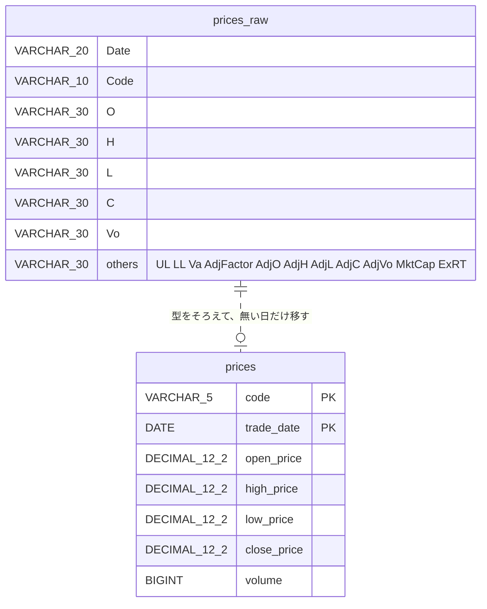

# 設計：株価の毎日の自動収集（`scripts/collect_daily.sh`）

Phase1 の ETL（集める → しまう）を、毎日1回自動で回す。手順は 2026-10-17 に本人が手で通したものをそのまま使う。

## 1. 画面一覧

画面は無い（コマンドラインで動くバッチ1本）。人が見るのは次の2つだけ。

| 見るもの | 中身 |
|---|---|
| 標準出力 | 下の「出してよい行」だけ |
| `logs/collect-YYYYMMDD.log` | 標準出力と同じ行に、時刻を付けたもの |

## 2. 処理の流れ（遷移）

```
開始
 → ① mssql が止まっていたら起こす → SELECT 1 が返るまで待つ（最大120秒・5秒おき）／返らなければ終了（exit 3）
 → ② collector/codes.txt を読む（空行と # の行は無視）／有効な銘柄が0件なら終了（exit 2）
 → ③ 銘柄ごとに繰り返す（2銘柄目からは前の取得から15秒あける＝1分に5回の回数制限）
      a. 取得：fetch_one <code> --save data/bars_<code>.csv  … 失敗したら FAILED stage=fetch を出して次の銘柄へ
      b. 取り込み：docker cp → TRUNCATE prices_raw → BULK INSERT → INSERT INTO prices ... WHERE NOT EXISTS
         … 失敗したら FAILED stage=load を出して次の銘柄へ
      c. 成功：<code> fetched=<件数> inserted=<件数>
 → ④ total rows=<prices の行数>
 → 終了：1銘柄でも失敗があれば exit 1、全部成功なら exit 0
```

## 3. 機能設計

| 機能 | 中身 |
|---|---|
| コンテナを起こす | `docker start mssql`。準備ができるまで `SELECT 1` で待つ |
| 表が無ければ作る | `IF OBJECT_ID('prices') IS NULL CREATE TABLE ...`（`prices_raw` も同じ） |
| 取得 | 既存の `collector/fetch_one.py --save`（PR #23）を `docker compose run --rm app` で動かす |
| 取り込み | 受け皿 `prices_raw` に CSV を全部文字で入れ、`prices` には「まだ無い（銘柄・日付）」だけを型をそろえて移す＝何回動かしても二重に入らない |
| 記録 | 下の「出してよい行」だけを標準出力とログに出す。子プロセス（docker・fetch_one・sqlcmd）の出力は、そのまま流さない |

### 出してよい行（これ以外は出さない）

```
START
<code> fetched=<数> inserted=<数>
<code> FAILED stage=<fetch|load> exit=<数>
total rows=<数>
END exit=<数>
no codes in collector/codes.txt
invalid line in collector/codes.txt
mssql not ready
```

株価の値・API キー・応答本文・CSV の中身は、どこにも出さない（J-Quants の規約で生データの配布は禁止。リポジトリは公開）。

## 4. ER 図（データの形）



- `prices_raw` は毎回 `TRUNCATE` してから使う使い捨ての受け皿
- `prices` の主キーは（銘柄コード, 日付）＝同じ日を二重に入れない

## 5. 受け入れ条件（数えられる形・番号で仕様と対応させる）

テストは `tests/test_collect_daily.sh`。`PATH` の先頭に偽物の `docker` を置き、本物の API・SQL Server を使わない。待ち時間はテストの中だけ環境変数で短くする（`COLLECT_WAIT_MAX`＝起動待ちの上限秒・既定120、`COLLECT_WAIT_STEP`＝起動待ちの間隔秒・既定5、`COLLECT_INTERVAL`＝銘柄の間の秒・既定15）。

- AC1 `bash -n scripts/collect_daily.sh` が通る
- AC2 成功：`codes.txt` に有効な2銘柄＋空行＋`#` の行 → 有効な2銘柄だけが処理され、各銘柄に `<code> fetched=<数> inserted=<数>` が1行、最後に `total rows=<数>`、`END exit=0`、終了コード 0
- AC3 取得の失敗：1銘柄目の取得が失敗 → `<code> FAILED stage=fetch exit=<数>` が出たあと2銘柄目も処理され、終了コード 1
- AC4 取り込みの失敗：1銘柄目の取り込みが失敗 → `<code> FAILED stage=load exit=<数>` が出たあと2銘柄目も処理され、終了コード 1
- AC5 有効な銘柄0件（空行と `#` の行だけ）→ `no codes in collector/codes.txt`、終了コード 2
- AC6 起動待ち：偽物の docker が `SELECT 1` に一度も成功しない → 待ちの上限で `mssql not ready`、終了コード 3。`SELECT 1` を試した回数が「上限 ÷ 間隔」を超えない
- AC7 間隔：2銘柄のとき、銘柄の間で `sleep` を `COLLECT_INTERVAL` の秒数で1回だけ呼ぶ（偽物の `sleep` で回数と秒数を記録して確かめる）
- AC8 出してよい行だけ：AC2〜AC6 の標準出力とログの全行が、§3 の「出してよい行」（ログは先頭に時刻）のどれかの形に一致する。偽物の docker が出す、株価に見立てた文字列（例 `PRICE-123.4`）が1つも出ない
- AC9 実機（人が行う）：1回目で `inserted` が今の `prices` に無い件数、続けて2回目で `inserted=0` かつ `total rows` が変わらない
